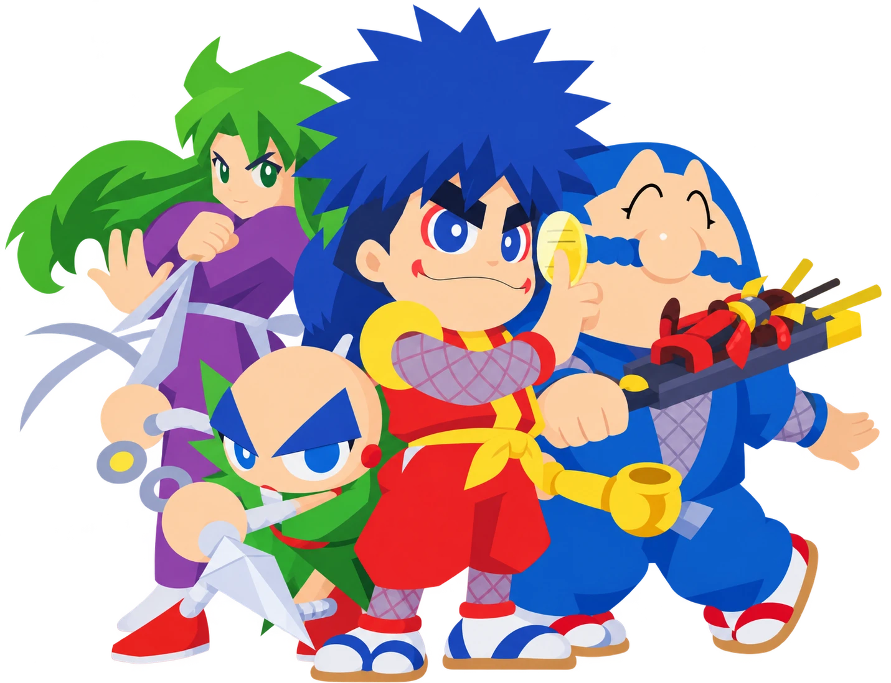

  

# GGA: Recompiled

GGA: Recompiled is a native PC port of the Nintendo 64 game **Goemon's Great Adventure** (Ganbare Goemon: Derodero
Douchuu Obake Tenkomori), made by **statically recompiling** the game's code with
[N64: Recompiled](https://github.com/N64Recomp/N64Recomp). It uses [RT64](https://github.com/rt64/rt64) to render the
game, with enhancements such as high framerates, widescreen and up to 4 players.

### [Download the latest release here](https://github.com/DreaXer/GGARecomp/releases)

### **This repository and its releases do not contain game assets. You need your own copy of the original game to play or build this project.**

> **Version 0.2.0 is an early release.** Worlds 1, 2 and 3 (with their castles and bosses) have been played from start
> to finish. World 4 has not been tested yet: expect problems there, and keep a backup of your saves.

## Supported ROM

Only the **US release** is supported:

| | |
|---|---|
| Header code | `NGME` |
| SHA-1 | `9f9e860816f9e2a68bb5f4f56086e0c7450c64d7` |

The Japanese and European releases cannot be played on their own, but the European one can add its languages (below).

### French and German (optional, European ROM)

If you also own the **European release** (*Mystical Ninja 2 Starring Goemon*), the game can use its French and German
texts:

| | |
|---|---|
| Header code | `NGMP` |
| SHA-1 | `aadd1d7e943cbfa5496a370158b5f8fe17b06415` |

1. Copy it, in `.z64` format, to `%LOCALAPPDATA%\GGARecompiled\` and name it `goemon2.eu.z64`: the same folder as
   `gga.us.z64` (the copy of your US ROM made by the launcher), **not** inside the `saves` folder.
2. Start the game: the title screen now shows **Option**, then **Language**, with **English / Français / Deutsch**,
   like the European release.

The dialogues, the font with accented letters, the title menu, the world map, the journal, the world title cards and
"Stage Clear" are translated. Without that file, nothing changes.

## System requirements

- Windows 10 or 11, 64-bit, or Linux x86-64 (tested on Ubuntu with X11). No macOS build yet.
- A GPU supporting Direct3D 12.0 (Shader Model 6) or Vulkan 1.2 (Vulkan only on Linux).
- A CPU supporting AVX.
- Windows: the [Microsoft Visual C++ Redistributable (x64)](https://aka.ms/vs/17/release/vc_redist.x64.exe). Most PCs
  already have it; without it, Windows reports a missing `MSVCP140.dll`.
- Linux: SDL2, GTK 3, FreeType and a Vulkan driver, for example on Ubuntu / Debian:
  `sudo apt install libsdl2-2.0-0 libgtk-3-0 libfreetype6 mesa-vulkan-drivers`.

If the game crashes on startup, update your graphics drivers first.

## How to play

1. Download `GGARecompiled-v0.2.0-windows.zip` (or `GGARecompiled-v0.2.0-linux.tar.gz`) from the
   [releases](https://github.com/DreaXer/GGARecomp/releases) and extract it anywhere.
2. Run `GGARecompiled.exe`. On Linux, open a terminal **in the extracted folder** and run `./GGARecompiled` (started
   from another folder, the game does not find its `assets` folder).
3. On first launch, the launcher asks for your Goemon's Great Adventure ROM. It is copied to
   `%LOCALAPPDATA%\GGARecompiled\` (Linux: `~/.config/GGARecompiled/`).
4. Start the game from the launcher.

Settings, controller mappings, saves and mods are stored in `%LOCALAPPDATA%\GGARecompiled\` (Linux:
`~/.config/GGARecompiled/`).

## Features

- **High framerate**: RT64 draws extra frames between the game's own, up to your monitor's refresh rate
  (Graphics > Framerate). Characters, carried players and scenery are interpolated.
- **Widescreen**: Aspect Ratio Expand shows more of the world in 16:9. Scenery, objects and enemies appear and wake up
  at the edges of the wider view, the 2D backgrounds fill the whole width, and the HUD stays at the bottom like the
  original. The startup logos stay centered, with white sides instead of black bands.
- **Up to 4 players**: the 1P / 2P menu also offers 3P and 4P (greyed out without enough controllers). Players 3 and 4
  are real players, with their own HUD, lives, money and weapons, kept between areas and levels, on the world map too.
- **Controller Pak saves**: saving and loading work like on the console (Controller Pak emulated on port 1).
- **Extra options** (General tab):
  - *Unlock Sasuke and Yae*: all 4 characters can be chosen from a new game, so every player gets one.
  - *Replay Castles*: a beaten castle (shown in ruins on the map) can be entered again and played in full, boss
    included.
  - *Draw Distance*: Original or x2 on the sides, the fog stays the game's.
- **RT64 texture packs** (`.rtz`) are supported through the Mods menu.
- Extra graphics options: MSAA, downsampling, high precision framebuffer, texture filtering, output filter, 2D upscale.

## Known issues

- Only Worlds 1 to 3 have been fully tested.
- Night-time enemies (levels played at night) have not been checked in widescreen yet.
- French and German: tested mostly in World 1, German less than French. Some screens with drawn text, and texts outside
  the dialogues, may stay in English.

## Reporting a bug

Open an [issue](https://github.com/DreaXer/GGARecomp/issues) with:

- the version (for example 0.2.0) and your Windows version or Linux distribution;
- where it happened (world, level, area), how many players, and what you did just before;
- what happened (freeze, crash, black textures, wrong sound…), with a screenshot if possible;
- your graphics settings (Framerate, Aspect Ratio);
- for a crash: run the game from a terminal opened in its folder with `GGARecompiled.exe --log gga-log.txt`, reproduce
  the crash, and attach `gga-log.txt` and `gga_crash.txt`.

## Building

Building needs your own ROM: the game's code is disassembled from it, then recompiled. Windows only.
The repository does not build from a fresh clone yet (its libraries are not added as submodules); building instructions
will come in a later version.

## Libraries used and projects referenced

- [N64: Recompiled](https://github.com/N64Recomp/N64Recomp) and
  [N64ModernRuntime](https://github.com/N64Recomp/N64ModernRuntime)
- [RT64](https://github.com/rt64/rt64)
- [Goemon 64: Recompiled](https://github.com/klorfmorf/Goemon64Recomp) by klorfmorf, whose application, launcher and
  runtime this project is based on, and [Zelda 64: Recompiled](https://github.com/Zelda64Recomp/Zelda64Recomp)
- [Donkey Kong 64: Recompiled](https://github.com/Rainchus/Donkey-Kong-64-Recompiled), for its build setup
- [splat](https://github.com/ethteck/splat) and [spimdisasm](https://github.com/Decompollaborate/spimdisasm)
- [SDL2](https://www.libsdl.org/), [RmlUi](https://github.com/mikke89/RmlUi)

Launcher artwork: by DreaXer, inspired by the game.

## License

GPL-3.0, like the projects it is based on, see [LICENSE](LICENSE). Goemon's Great Adventure is the property of Konami; this project is not
affiliated with Konami.
